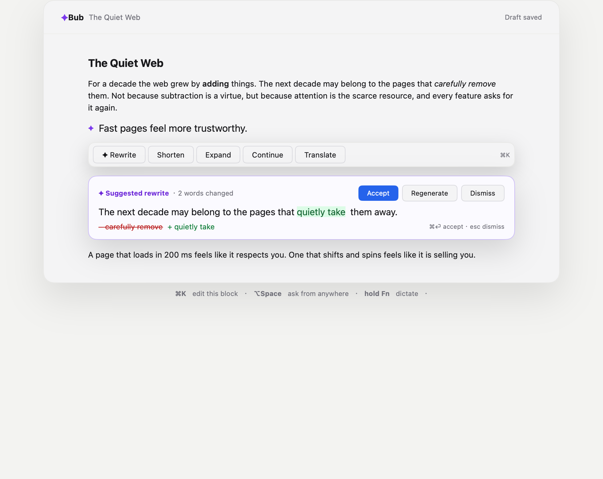
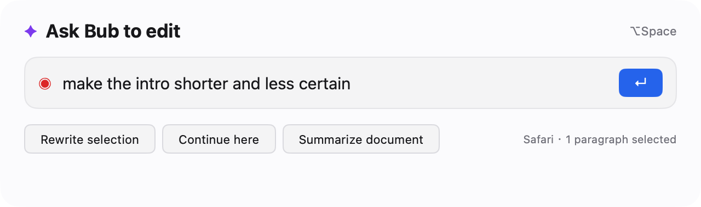

# Bub Desktop: from chat client to an AI-native writing surface

Status: historical proposal. The first phase (block editor, block actions,
inline suggestions, Markdown files) shipped first; Bub Desktop has since grown
into the Notion-like app described in [DESIGN.md](DESIGN.md) — pages and a
sidebar, a `/` block menu, draggable blocks, a contents rail, an AI chat rail
and settings. The standby bar, voice and multi-window phases below are still
not built. This document is kept as the design record that started the editor.





## 1. Thesis

- **The document is the conversation.** Every AI action happens on text that
  already exists, and its result appears where that text is. There is no
  transcript to scroll back through, no message bubbles, no "Send".
- **A suggestion is not an edit.** The agent proposes; the person accepts,
  regenerates or dismisses. Nothing enters the document, or its undo history,
  until accepted.
- **Ambient, not modal.** A shortcut or a held key wakes a small bar, a voice
  command becomes an instruction, and the surface disappears again. Nothing
  needs to be "open" for the agent to be available.
- **Block-first.** Headings, paragraphs, lists, quotes and code are blocks
  with stable IDs. Actions target blocks or selections inside them, so
  "shorten this", "continue this", "translate this" are unambiguous.
- **Quiet by default.** No autopilot, no inserted text without a preview, no
  unsolicited panels. Agent activity is a small status, not a conversation.

What we keep: the ACP client (`desktop/internal/acp`), the `bub acp` agent
server, and the theory that UI and agent share only JSON-RPC over stdio.

## 2. Interaction model

### 2.1 Writing

A document window with one centered writing column, a title line, and a block
gutter. Everything is the rich-text editor from `ui/richtext`: headings,
lists, tasks, quotes, fenced code, links, inline formatting, images, undo,
Markdown shortcuts and Markdown/HTML export already work. The app adds block
chrome, not a new text model.

### 2.2 Block actions

The caret's block gets a quiet `✦` in the gutter (on hover, or when the caret
enters it). `⇧⌘R`, the gutter button, or the context menu opens a bar anchored
to the block:

| Action | Prompt shape |
| --- | --- |
| Rewrite… | freeform instruction ("make it warmer, less certain") |
| Shorten / Expand | one paragraph or selection |
| Continue | the block plus the preceding blocks as context |
| Translate… | language picker |
| Tone: Formal / Casual / Tighter | presets |
| Summarize block / document | current block or outline |

A text selection inside a block narrows the target to that range; a
multi-paragraph selection targets those blocks. The block's paragraph style
(heading level, list, quote, code) is **not** changed by the result; only the
text is.

### 2.3 The suggestion

While the agent answers, the suggestion streams into a card in the page, under
the target block — not into the document. It shows:

- a short label ("Suggested rewrite", "2 words changed") and a streaming body;
- a compact review of the change (`− old · + new`, or word-level colouring);
- **Accept** (`⌘⏎`), **Regenerate** (`⌘R`), **Dismiss** (`Esc`);
- for long rewrites, a **Diff** toggle that swaps the card body for
  `editor.DiffView` (side-by-side or unified, with `HunkActions`).

Accept applies one `Document.Edit` step: one undo entry, IDs and styles
preserved, provenance recorded. Dismiss restores the caret and writes nothing.
Starting another action cancels the first (ACP `session/cancel`).

### 2.4 Continue and ghost text

Phase 1 ships Continue as a suggestion ("write the next paragraph"). Once the
editor exposes a caret rectangle and key hooks (see §6), a lighter version
appears after a pause in typing: a muted ghost sentence after the caret, `Tab`
accepts, `Esc` dismisses, and it is never inserted without the key. Ghost text
is deliberately **not** in the first MVP: it needs a faster model path and the
caret-level APIs.

### 2.5 Standby bar (the "Siri" surface)

`⌥Space` anywhere (inside the app or over another app) opens a small glass
panel: one input line, a microphone, and a context chip that says what the
command will act on (`Draft · paragraph 4`, `Safari · 1 paragraph selected`,
`Clipboard`). Type or hold to speak; the intent runs; the result previews
inline or is copied. `Esc` or clicking away hides it.

Two modes, one surface:

- **Dictate** (hold `Fn`, or the mic button): speech becomes text at the
  caret, or in the standby input. Partial transcripts appear as they come;
  release commits; `Esc` cancels.
- **Command** (hold `⌥Space`, or the mic in command mode): speech becomes an
  instruction. "Make this intro shorter" is applied to the selected block,
  and answers as a suggestion. The transcript is never inserted.

No wake word in the first versions: an always-listening microphone costs
privacy, battery and permission friction, and a global hotkey already gives
the "standby wake" feeling. Wake-word spotting can be a later experiment with
a local keyword model.

### 2.6 Multi-document

The app becomes document-based: one window per file, New/Open/Save/Recent,
autosave, crash recovery, files changed by other apps, and drag-and-drop to
open. An outline sidebar (headings) and word count are small additions later.

## 3. Architecture

```
┌──────────────────────────────────────────────────────────────────┐
│ Go / MyGo app                                                    │
│                                                                  │
│  document window: richtext.Document + block chrome               │
│        │                                                         │
│        ├── block actions ──► action engine ──► ACP client ───────┼── stdio ──► bub acp
│        │                         │                               │             (BubFramework
│        ├── suggestion card ◄─────┘                               │              turn + model)
│        │                                                         │
│  standby panel (global shortcut) ──► same action engine          │
│  voice input (system dictation / Swift ASR helper) ──► text      │
└──────────────────────────────────────────────────────────────────┘
```

The existing `internal/acp` client (a thin adapter over the Go ACP SDK since the
SDK migration) stays: `initialize`, `session/new`, `session/prompt`,
`session/update`, `session/cancel`. One ACP session per open
document (`cwd` = document folder), so each document has its own tape in Bub
and actions do not bleed into each other.

### 3.1 Document model

Use `ui/richtext` rather than a new block engine:

- `richtext.Text` is paragraphs (blocks) of runs, with `ParagraphStyle`
  (heading, list, indent, quote, code, align) and a stable `Style.ID`.
- `Document` holds the text, selection and undo history; its methods are safe
  from any goroutine, and `Edit` applies a change as one undo step.
- `Text().Paragraphs()` yields `(startOffset, Paragraph)`; a selection maps to
  blocks by rune offsets. `VisibleParagraphs()` gives on-screen boxes for the
  gutter and for anchoring action UI.
- `Markdown()` / `HTML()` export; `ParseMarkdown()` / `ParseHTML()` import.
  Clipboard already keeps rich formatting.

Block chrome is app state keyed by paragraph ID: suggestion, provenance,
collapsed state, comments later. It is **not** stored in the paragraph text.

### 3.2 The action engine

```go
type Action struct {
    Kind     string   // rewrite, shorten, expand, continue, translate, custom
    Target   Target   // one block, a selection range, or the whole document
    Prompt   string   // the person's words, if any
    Context  []Block  // neighbours + outline within a token budget
}

type Suggestion struct {
    BlockID  string
    Before   string   // plain text of the target
    After    string   // streamed replacement
    Status   string   // streaming, ready, failed, cancelled
}
```

- The prompt is assembled client-side today: instruction + target text +
  limited context (title, outline, preceding/following blocks). The **output
  contract is "only the replacement text"**; the client strips fences, refuses
  empty answers, and never applies without preview.
- Streaming: `agent_message_chunk` → `Suggestion.After`; updates batched to
  ~30 fps through `win.Update`; one in-flight action per document; a new
  action cancels the old one.
- Tool calls: action prompts are writing tasks, so tools are not offered to
  the model by default. If the agent emits one anyway, map it to a one-line
  activity indicator, not a chat row.
- Timing and errors: the card shows "Thinking…", streams, and on failure
  offers Retry. It never blocks editing: the person can keep typing elsewhere
  while an action runs; if the target block changed under it, the suggestion is
  marked stale and Accept is disabled.

### 3.3 ACP contract, two stages

**Stage 1 (no server change).** `session/prompt` with a text prompt containing
a small, stable instruction block:

```
You are editing one paragraph of a document. Reply with the replacement
paragraph only: no quotes, no fences, no explanation.

Instruction: shorten by about 30%, keep the meaning
Paragraph: Fast pages feel more trustworthy.
```

This works with today's `bub acp`. Its weaknesses: the model can drift into
explanation, the client must parse, and there is no explicit action metadata.

**Stage 2 (small `bub acp` extension).** Put the action in `_meta` of
`session/prompt`:

```json
{
  "method": "session/prompt",
  "params": {
    "sessionId": "...",
    "prompt": [{"type": "text", "text": "shorten by about 30%"}],
    "_meta": {
      "bub/action": {
        "kind": "rewrite",
        "target": {"blockId": "..."},
        "context": "...",
        "output": "replacement-text"
      }
    }
  }
}
```

`bub acp` passes `_meta["bub/action"]` into the turn state; a small builtin
plugin (or a bundled skill) builds the prompt and enforces the output
contract, and can route `kind: "complete"` to a faster model. ACP allows
`_meta` without a protocol bump, so the desktop client and other clients keep
working. A dedicated extension method is only worth it if we later need
structured JSON edits for multi-block operations.

Provenance is recorded client-side (`blockID`, action, model, before/after
hashes, time) in a sidecar next to the document, and the edit itself is one
undo step, so Cmd-Z and a future "AI edits" review panel both work.

## 4. Voice

MyGo v0.8.3 has no audio input: `audio/` plays sound, and microphone capture
lives in **native modules**, which are only on MyGo main (unreleased). The
options, in order of cost:

| Option | Works on v0.8.3 | Partials | Notes |
| --- | --- | --- | --- |
| macOS system dictation (Fn Fn) | yes, no code | OS UI only | Free, on-device, permission handled by the OS; no control of partials, no command mode |
| Swift helper binary using `SFSpeechRecognizer` + `AVAudioEngine` | yes, as a child process | yes | ~200 lines; speaks NDJSON on stdout; needs `NSSpeechRecognitionUsageDescription` and mic permission in the app bundle; no cgo |
| MyGo native module (Swift) | needs MyGo main | yes | Cleanest: `mygo:native` interface `Samples`/partials, built by `mygo build`; experimental API |
| `whisper.cpp` child process | yes | yes, chunked | Offline, cross-platform, larger download and latency |

Recommended path: ship **system dictation** behind the mic button in phase 2
(it needs no code and works in the standby input), and prototype the **Swift
helper** for push-to-talk with partials. When MyGo's native modules land in a
release, move the helper into a module so `mygo build` signs and bundles it.
Voice is a capture front-end; the command/dictation distinction is app logic,
not ASR logic.

Permissions: the helper's `Info.plist` needs
`NSSpeechRecognitionUsageDescription` and `NSMicrophoneUsageDescription`; a
signed app is needed to keep them across builds. `mygo.json` can carry the
app's own `macos.infoPlist` keys.

## 5. MyGo UI mapping (verified against v0.8.3)

The API probe in `/tmp/editor-probe` compiles against `github.com/egoist/mygo
v0.8.3`; it exercises the pieces below.

| Need | MyGo API | Notes |
| --- | --- | --- |
| Rich text editor | `ui/richtext.EditorBase(c, doc, opts)` | paragraphs = blocks, IDs, Markdown shortcuts, undo |
| Programmatic edit | `doc.Edit(func(e *richtext.Edit){ e.ReplaceString(...); e.Select(...) })` | one undo step; safe from goroutines |
| Block geometry | `doc.VisibleParagraphs() []ParagraphBox` | `Top`, `Height`, `Index`, `Start`; rebuilds when layout moves |
| Gutter | `ui.Box(...).Draw(...)` or absolute `ui.Text("✦").Absolute().Left(-30).Top(box.Top)` | hover/active state is app state; `ParagraphBox` lines it up |
| Action bar | `ui.Row` of buttons, `.Absolute().Left().Top()` next to the block | v0.8.3 anchors to the block, not the caret |
| Suggestion card | `ui.Column` in the page flow (recommended) or absolute overlay | flow avoids overlaps, keeps selection/accessibility |
| Diff | `ui/editor.DiffView(c, &editor.DiffState{...})` | line-based code look; `HunkActions`, `Editable`, `FitContent` |
| App shortcuts | `c.Shortcut(ui.Cmd, ui.KeyK)` | v0.8.3 has no key hook inside the editor |
| Long lists / scrolling | editor handles its own scrolling; window + `ui.List` for outline/sidebar later |
| Standby panel | `mygo.NewWindow(WindowOptions{Panel, Hidden, Frameless, Transparent, Vibrancy: mygo.VibrancyGlass, ...})` | floats over other apps, hides on blur/Esc |
| Wake shortcut | `mygo.GlobalShortcut.Register("Alt+Space", toggle)` | fails if taken; let the user choose |
| Background app | `LSUIElement` in `mygo.json`, `App.SetActivationPolicy(Accessory)` | launcher-style app, optional tray icon |
| Documents | `mygo.NewDocuments(DocumentsOptions[content]{...})` | autosave, recovery, File menu, reopen |
| Theme | `richtext.EditorOptions.Theme`, window theme | sky-blue accent only for AI surfaces |
| Testing | `ui.NewTester`, `ui.Render`, MyGo automation plugin | gutter/anchoring logic and the standby view are testable headlessly |

### What v0.8.3 cannot do (and the workaround)

- **No caret rectangle** (`Document.CaretRect` is on MyGo main): anchor the
  action bar to the block box, not to the caret. Good enough for block-level
  actions; caret-level popovers wait for the upgrade.
- **No key hook inside the editor** (`EditorOptions.OnKey` is on main): accept
  with a global shortcut (`⌘⏎`) and buttons; the editor keeps its own keys.
- **No native modules** (main only): see §4.
- **No ghost text**: needs both the caret rectangle and a key hook; until then
  "Continue" is a suggestion card.

Decision to make: pin MyGo to **main** (pseudo-version) for the editor branch,
which unlocks caret popovers, `OnKey`, ghost text and native modules, at the
cost of an unreleased API; or stay on **v0.8.3** and ship the block-anchored
version first. The probe shows the v0.8.3 version is a complete product for
block actions, the standby bar and voice via the Swift helper; the main-only
APIs are polish (ghost text, caret popovers), not the core.

## 6. Data and files

A document file keeps the rich text and its AI metadata. Two shapes:

1. `.bdoc` — `{"text": <richtext JSON>, "meta": {...}}`, read/written by
   `DocumentsOptions[Document]{Read, Write}`; export to Markdown/HTML on
   demand; import Markdown/HTML.
2. Markdown file + sidecar `.bdoc.meta` — friendlier in git, but loses fonts,
   colors, underlines and alignment (Markdown cannot carry them). For a writing
   app, prefer (1).

`richtext.Text` JSON already round-trips paragraph IDs; the sidecar holds
per-block provenance (`lastAction`, `model`, timestamp) and UI state (collapsed,
comments later). Autosave 5 s after the last edit, recovery after a crash, and
`Equal` based on the text so undo back to the file's state clears "edited" —
all from `mygo.NewDocuments`.

## 7. Delivery plan

### Phase 0 — spike (2–3 days)

- Window with a `Documents`-backed richtext editor; block gutter; `⇧⌘R` action
  bar; one "Rewrite" action through `bub acp`; streaming suggestion card;
  Accept applies one undo step.
- **Accept when**: a real model reply can be accepted and undone, and the
  document is saved/reopened with IDs intact.

### Phase 1 — block actions (1–2 weeks)

- Full action vocabulary, selection-aware targets, context assembly, stale
  detection, Regenerate, Diff toggle, cancellation, error/Retry.
- Provenance sidecar; "AI edited" hover hint; keyboard path.
- **Accept when**: a writer can rewrite a paragraph, undo it, and export
  Markdown without leaving the keyboard.

### Phase 2 — standby and voice input (1 week)

- `⌥Space` glass panel with context chip, intent chips and clipboard target;
  global shortcut settings; tray icon.
- System dictation in the editor and the bar; command mode routes spoken
  instructions to the action engine.
- **Accept when**: from another app, `⌥Space` → "make this shorter" → preview
  and copy works without opening the document window.

### Phase 3 — caret-level polish (1–2 weeks, after the MyGo decision)

- Upgrade to MyGo main (or the next release): `CaretRect`, `OnKey`, `Spans`;
  caret-anchored menu, inline ghost completion, Tab to accept.
- Outline sidebar, word count, focus mode, document search.

### Phase 4 — real voice (1–2 weeks)

- Swift helper or native module with partial transcripts and push-to-talk;
  permission flow; offline fallback via whisper.cpp behind a setting.
- Optional: accessibility-based cross-app selection (read selection and insert
  text in other apps), with an explicit opt-in and permission walkthrough.

## 8. Testing and evaluation

- **Logic tests (Go, no UI):** prompt assembly per action, output validation
  (fences, empty replies, explanations), stale-target detection, applying a
  suggestion as one undo step, provenance records.
- **Client tests:** the existing scripted fake agent in `internal/acp` can
  stream chunks, tool noise, errors and cancellation; the action engine is
  tested against it without a model.
- **View tests:** `ui.NewTester` for the action bar and suggestion card;
  `ui.Render` for golden mock frames (the images in `design/` are the start);
  the MyGo automation plugin for end-to-end runs against a real `bub acp`.
- **Evaluation:** median time to first token, accept rate, edit-after-accept
  rate (accepted suggestions that are then changed), undo rate right after
  accept, actions per writing session, and how often the standby bar is used
  without opening a document window. Those tell whether the "no chat" model
  actually works for people.

## 9. Risks and open questions

- **MyGo version**: main unlocks the caret-level APIs and native modules but
  is unreleased. Decide per phase; do not mix pseudo-versions silently.
- **Output drift**: models explain instead of replacing. Mitigate with a
  strict prompt, a client-side validator (reject code fences/explanations), a
  "Regenerate" path, and later the `_meta` contract.
- **Undo semantics**: suggestions must not touch the document until accepted;
  streaming previews are client state only. If the target changes mid-flight,
  mark stale and refuse to apply.
- **Latency**: first token on a strong model can be seconds. Show "Thinking…",
  allow editing elsewhere, use a fast model for Continue/compile-like actions,
  cache nothing sensitive.
- **Privacy**: document text goes to the model. Document the boundary, allow
  local models through `BUB_MODEL`/`BUB_API_BASE`, and never auto-send a whole
  document except for explicit "Summarize document".
- **Cross-app actions**: reading another app's selection and inserting text
  needs Accessibility; keep it opt-in and out of the MVP.
- **Tables, embeds, databases**: `richtext` has no tables; Notion parity here
  would be a separate custom block widget, not this editor. Keep the scope to
  prose, lists, quotes and code for the first version.
- **Collaboration**: not in scope; paragraph IDs are a foundation for it later.

## 10. What to decide now

1. Pin MyGo v0.8.3 for the first iterations, or main for caret/voice features?
2. Document format: `.bdoc` JSON (recommended) vs Markdown + sidecar.
3. Voice first step: system dictation only, or a Swift ASR helper spike in the
   same phase?
4. Standby scope: in-app only at first, or the system-wide panel (global
   shortcut) from phase 1?
5. Keep the ACP chat window as a hidden fallback, or remove it entirely in the
   editor branch?
