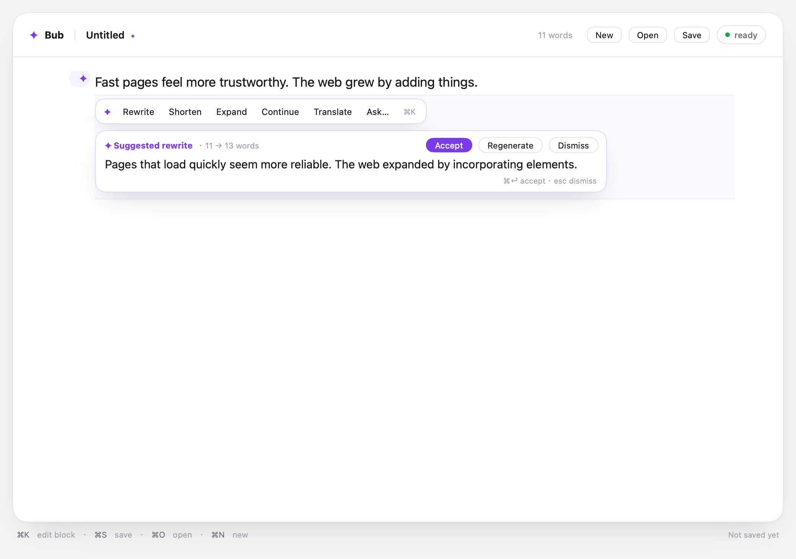

# Bub Desktop

A native **Markdown editor** for [Bub](../../README.md) where the agent works on
blocks, inline, instead of chatting. Written in Go with the
[MyGo](https://mygo.egoist.dev) UI toolkit and connected to a Bub agent through
the [Agent Client Protocol](https://agentclientprotocol.com) (ACP) v1 over
stdio.

The document is the conversation. Put the caret in a paragraph, press `⌘K` (or
click the quiet `✦` in the gutter), and pick **Rewrite**, **Shorten**,
**Expand**, **Continue**, **Translate**, or **Ask…**. The agent streams a
suggestion for that block into a small card beside it; nothing enters the
document — or its undo history — until you **Accept**. There are no chat rows,
no bubbles and no Send button.

The window draws itself with MyGo's native UI: no webview, no browser runtime,
no CGO. The agent is a separate `bub acp` process; the two halves share no code,
only ACP.

The wire protocol — JSON-RPC 2.0, typed ACP v1 messages, stdio framing, request
correlation and subprocess lifecycle — is handled by
[`github.com/caelis-labs/acp-go-sdk`](https://github.com/caelis-labs/acp-go-sdk)
v1.6.0 (Apache-2.0). `internal/acp` is a thin adapter over it: it spawns the
agent, maps typed session updates to the suggestion model the editor renders,
and declines capabilities the window does not implement.

See [DESIGN.md](DESIGN.md) for the contract between the two halves.
[EDITOR_PLAN.md](EDITOR_PLAN.md) is the design proposal this implements (its
later phases — the standby bar, voice, multi-document — are not in this build).

```
┌──────────────────────────────────┐    ACP v1, JSON-RPC 2.0, one per line   ┌───────────────────────────┐
│  Bub Desktop (Go, MyGo)          │  ── initialize, session/new ─────────► │  bub acp (Python)         │
│  richtext editor + ⌘K bar        │  ── session/prompt (one block) ───────► │  BubFramework turns       │
│  block gutter + suggestion card  │  ◄─ session/update: message chunks ──── │  model, tools, tape       │
│  file Open/Save (Markdown)       │  ◄─ session/prompt response ─────────── │                           │
│  internal/acp adapter            │  ── session/cancel ───────────────────► │  asyncio task cancellation│
└──────────────────────────────────┘                                        └───────────────────────────┘
        client                                                                agent
```



## What is in the box

| Path | What it is |
| --- | --- |
| `main.go` | App state, theme, window setup, and the agent wiring (`connect`, handshake, reconnect, notification routing). |
| `view.go` | The interface: header with document name/dirty marker/word count/status, block gutter, anchored action bar and suggestion card (docked above the footer when a block is too low), error banner, footer keys. |
| `editor.go` | The document and the action engine: paragraphs as blocks with stable IDs, prompt building, suggestion streaming/accept/undo/stale checks, file Open/New/Save through Markdown. |
| `internal/acp/` | The ACP adapter over the Go SDK (see below), unchanged by the editor redesign. |
| `main_test.go` | Prompt construction, block lookup by paragraph ID, apply-as-one-undo-step, stale refusal, Markdown load/save round trip, streaming mapping, and `ui.NewTester` view tests (no window, no network). |
| `e2e.go` | `-tags e2e` only: registers MyGo's automation plugin so the running window can be driven from outside. |
| `mygo.json` | App metadata for `mygo build` (name, bundle identifier, version, output directory). |
| `resources/icon.png` | The Bub mark, also the app icon by MyGo's convention. |
| `design/` | The redesign mock (`editor.png`, `standby.png`) from the proposal. |
| `screenshot.png` | A render of the editor with an inline suggestion. |

## Running it

The agent command comes from `BUB_ACP_CMD` (default `bub acp`), split like a
shell splits words. Its working directory — and the ACP session's `cwd` — is
`BUB_ACP_WORKSPACE` when set, else the app's own working directory.

From a checkout with the Python environment installed (`uv sync`):

```sh
# from the repo root, so the agent sees the whole project
export BUB_ACP_WORKSPACE="$PWD"
export BUB_ACP_CMD="uv run bub acp"
cd desktop && go run .
```

`BUB_ACP_WORKSPACE` is what pins the agent to the repo root even though
`go run` starts from `desktop/`; without it the agent's workspace is `desktop/`.

With a `bub` already on `PATH`:

```sh
cd desktop
BUB_ACP_CMD="bub acp" go run .
```

Packaged builds use MyGo's own tools, which read `mygo.json`:

```sh
cd desktop
go run github.com/egoist/mygo/cmd/mygo@v0.8.3 build   # bundle in build/
go run github.com/egoist/mygo/cmd/mygo@v0.8.3 dev     # rebuild and relaunch on change
```

Go is not necessarily on `PATH` in a non-interactive shell; on a Homebrew setup
`export PATH=/usr/local/opt/go/bin:$PATH` first.

### Environment

| Variable | Meaning | Default |
| --- | --- | --- |
| `BUB_ACP_CMD` | The agent command line. Quotes group arguments. | `bub acp` |
| `BUB_ACP_WORKSPACE` | The agent's working directory and the session's workspace. | the app's working directory |
| `BUB_MODEL` | Shown in the footer until the agent reports its own name; the agent reads it too. | unset |
| `MYGO_AUTOMATION` | Socket path for the automation plugin, in `-tags e2e` builds only. | unset |

## Writing

The page is a [`richtext`](https://pkg.go.dev/github.com/egoist/mygo/ui/richtext)
document: headings, paragraphs, lists, tasks, quotes, code blocks, links,
inline formatting and Markdown shortcuts (`# `, `- `, `> `, `**bold**`, `$`
math, …) all work as the editor does, with undo and redo.

| Key | Does |
| --- | --- |
| `⌘K` | Open the block actions for the caret's paragraph. |
| `⌘↩` | Accept the suggestion. |
| `⌘R` | Regenerate the suggestion. |
| `Esc` | Dismiss the action bar or the suggestion. |
| `⌘N` | New document (asks before discarding unsaved changes). |
| `⌘O` | Open a Markdown file (`.md`, `.markdown`, `.mdown`, `.txt`). |
| `⌘S` | Save as Markdown; asks for a path the first time. |

`⌘` is the platform's command modifier (Ctrl on Linux and Windows).

Files are read with `richtext.ParseMarkdown` and written with
`Text().Markdown()`, so a file opened and saved keeps its Markdown structure;
formatting Markdown cannot carry (colors, fonts, underline) is not saved. File
dialogs are `mygo.Dialog.Open/Save`; they block, so they run off the view
goroutine and the window updates when they return.

Each paragraph gets a stable ID from `Document.IdentifyParagraphs`. An action
captures its target's ID and text; on Accept the app finds the paragraph by ID
again, and refuses (marks the suggestion stale, disables Accept) if it changed,
moved or disappeared.

## Block AI

**The action bar.** `⌘K` or a click on the paragraph's gutter `✦` opens a small
bar under the block: Rewrite, Shorten, Expand, Continue, Translate, Ask….
**Ask…** adds a one-line instruction input and a Generate button. Choosing an
action sends one `session/prompt` — there is one agent turn at a time, and a new
action cancels and queues behind the running one.

**The prompt.** One text block, assembled in `editor.go`: the document title, the
task (e.g. "Shorten the paragraph below by about 30%, keeping its meaning, voice
and tense."), the target paragraph, and the preceding/following paragraph
trimmed to a few hundred characters. It asks for *the replacement paragraph
only* — no quotes, no fences, no explanation. The answer is trimmed of wrapping
code fences and quotation marks; an empty answer is a failed suggestion, never an
edit.

**The suggestion.** `agent_message_chunk` notifications stream into a card
anchored under the target block, labeled "Suggested rewrite" (or shortening,
expansion, continuation, translation, edit) with a words-changed summary. While
it streams there is **Stop** (sends `session/cancel`); when ready, **Accept**,
**Regenerate**, and **Dismiss**. Accept applies one
`Document.Edit` — one undo step, by the paragraph's ID, keeping its heading/list/
quote style — marks the document dirty and closes the card. Continue inserts the
answer as the next paragraph instead of replacing. `Esc` dismisses anything.

**Tool calls and thoughts** never create messages: a small label in the header
shows "Thinking…" or the tool that is running while a suggestion is in flight.

**Placement in MyGo v0.8.3.** `Document.VisibleParagraphs()` returns each visible
paragraph's `Top`/`Height` in the editor's coordinates, read as the view builds.
The gutter and the AI stack are absolutely positioned siblings of the
`richtext.EditorBase`, using those boxes, so they line up with the block and
follow scrolling (the editor asks for another frame when layout moves them).
When the block is too low on the page for the card, the surfaces dock above the
footer instead — the same widgets, in the flow. The suggestion paints a
violet-tinted band over the lines beneath it so the covered text does not peek
around the card.

## How it works

**Connection.** On start the app spawns the agent, then runs `initialize`
(`protocolVersion: 1`; `clientCapabilities` with no filesystem and no terminal)
and `session/new` (`cwd` absolute, `mcpServers: []`) — one session for the app
run. The header chip says `connecting`, then `ready`, `running` during a turn,
`offline` when the agent goes away. If either step fails — `bub` missing, `uv`
failing, a handshake timeout of 20 s — the editor stays usable, shows the error
with the tail of the agent's stderr, and offers **Retry**, which respawns it.

**Updates.** `session/update` notifications are folded into the AI surface:

| ACP update | In the editor |
| --- | --- |
| `agent_message_chunk` | Appended to the streaming suggestion's text. |
| `agent_thought_chunk` | Only sets the small "Thinking…" activity label. |
| `tool_call` / `tool_call_update` | Only set/clear the activity label ("Running read…"). |
| `plan`, `available_commands_update`, unknown updates | Ignored. |

The SDK skips a malformed line from the agent rather than failing the
connection. A request the client does not implement (it answers permission
requests as "declined", and offers no `fs/*` or `terminal/*` capability) is
answered by the SDK with JSON-RPC error `-32601`, so the agent never waits.

**Threading.** Everything that mutates the document or the AI surface runs on
the main thread through `win.Update`: the SDK's notification goroutine only
queues updates, and file dialogs and reads/writes run off it. The agent never
blocks a frame, and the view never blocks on the agent. Tests build the same
view with `ui.NewTester`, where there is no window and state changes apply
directly.

**Errors.** A failed handshake, a dead agent, or a failed turn set a red banner
in the header area with **Retry**. A failed suggestion shows its error inside
the card. Neither ever becomes a chat message.

## Keys for automation

For `-tags e2e` builds driven through `MYGO_AUTOMATION`, these elements have
stable keys:

| Key | Element |
| --- | --- |
| `editor` | The editor, keyed with `ui.Key` via `c.Key("editor")`. |
| `status` | The connection chip's text: `connecting`, `ready`, `running` or `offline`. |
| `error` | The error banner, when it shows. |
| `file-new`, `file-open`, `file-save` | Header buttons for the file actions. |
| `ai-block-<index>` | The `✦` of the paragraph at that document index, while it is visible. |
| `ai-rewrite`, `ai-shorten`, `ai-expand`, `ai-continue`, `ai-translate`, `ai-ask` | Action bar buttons. |
| `ai-instruction` | The Ask… input; `ai-generate` submits it. |
| `ai-accept`, `ai-regenerate`, `ai-dismiss` | Suggestion card buttons. |
| `ai-stop` | Stop, while a suggestion streams. |

```sh
cd desktop
go build -tags e2e -o build/bub-desktop .
MYGO_AUTOMATION=/tmp/bub-desktop.sock ./build/bub-desktop &
mygo-automation --socket /tmp/bub-desktop.sock windows
mygo-automation --socket /tmp/bub-desktop.sock tree --window 1
mygo-automation --socket /tmp/bub-desktop.sock capture --window 1 > shot.png
```

## Tests

```sh
cd desktop
go build ./...
go build -tags e2e ./...
go test ./...
go vet ./...
```

`internal/acp` tests need no process and no network: a fake agent answers over
an SDK loopback connection, and a spawned `testdata/agent` covers the real
process path. The `main` tests drive the action engine directly (prompts,
block IDs, one-step undo, stale targets, Markdown round trip) and the view with
`ui.NewTester`; they open no window and start no agent.

## Limitations

- **One document window.** No tabs, no session restore, no autosave and no crash
  recovery; `⌘N`/`⌘O` ask before discarding unsaved changes.
- **Markdown only.** Save writes Markdown, so formatting it cannot carry
  (colors, fonts, underline, alignment) is lost on save; paragraph IDs live for
  the session and are not stored in the file.
- **One block at a time.** Actions target the caret's block (or the clicked
  gutter block), not a multi-paragraph selection.
- **The inline card covers following lines** while it is open; dismiss it or
  scroll the block up to see them. The docked fallback keeps everything visible.
- **No diff view.** The card shows the new text and a word-count change, not a
  word-level diff.
- **`⌘K` is the block action shortcut**, so the editor's link shortcut is
  unavailable; links can still be edited by other editor commands.
- **Light theme only.** The zinc palette is fixed; the window does not follow
  the desktop's dark appearance yet.
- **No permissions UI.** `session/request_permission` is answered with the
  "cancelled" outcome, so a tool that needs consent does not run. Bub's tool
  denials via hooks still work in the agent; no `fs/*` or `terminal/*` request is
  served (the SDK answers `-32601`).
- **Text prompts only.** No image, audio, embedded-resource or file attachment
  prompts; the action prompt carries only the block and its neighbours.
- **Word count is whitespace-based**, as a rough guide for prose.
- **No voice, no standby bar, no ghost text** — later phases in
  [EDITOR_PLAN.md](EDITOR_PLAN.md).
- **`BUB_ACP_CMD` is split like a shell but not by one.** Pipes, `&&` and
  environment assignments are not interpreted; use quotes for arguments with
  spaces.
