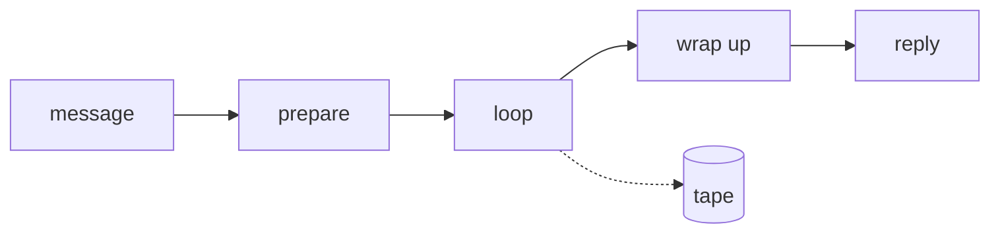

import { CardGrid, LinkCard } from '@astrojs/starlight/components';

## Background {#background}

Bub used to keep everything in the main package. Every new message channel meant another class under `bub.channels` plus a batch of tools or skills, and every new capability meant another switch. The author recorded the call at the time in [Why we rewrote Bub](/posts/why-rewrite-bub/):

> If we kept going in that direction, Bub would eventually become another Nanobot, or even another OpenClaw. [...] Most users only need one or two providers and one or two channels, yet they still end up staring at a wall of settings and switches. Even if most of them are disabled by default, the complexity is still there, and users still get lost in it.

So the rewrite took the opposite direction:

> My answer is to split extra functionality out of the core and move to a model with a **carefully designed lightweight kernel** plus **freely vibe-coded feature plugins**.

The kernel has to be stable, understandable by agents, and quality-controlled by maintainers. Plugins can be written however people like, even generated on the spot by an agent. One maintenance model is strict; the other is loose.

Which raises the question: **once the pieces are split, where do the boundaries go?** This section is those boundaries. The four cards below lead to one page each.

## The journey of one interaction {#journey}

Take the most common interaction: you ask something in the terminal, and Bub answers.

**Prepare** decides which session the message belongs to, restores what the previous turn left behind, and turns the message into a prompt. **Loop** takes the prompt to the model, runs any tools the model asks for, feeds the results back into the context, and asks again until the model answers without asking for tools. **Wrap up** saves the result, packages it as an outbound message, and hands it to the channel.

Of the three, only the middle one is general. It does not matter whether the message came from a terminal, Telegram, or anywhere else: the "model ⇄ tools" stretch is identical. The two stages around it both deal with where a message comes from and where the reply goes, and that is exactly the part that changes with deployment.

That is where the line falls. The loop stays in the kernel; both ends belong to the app.

## Responsibility boundaries {#concepts}

Along that line, Bub splits into four responsibility boundaries. They have no required order; browse them as you need.

<CardGrid>
  <LinkCard
    title="Turn"
    description="Defines the full flow. One message from arrival to reply can be split into named stages."
    href="/docs/concepts/turn/"
  />
  <LinkCard
    title="Tape"
    description="Provides history and context. The record is append-only, and the model reads from a starting point you choose."
    href="/docs/concepts/tape/"
  />
  <LinkCard
    title="Events"
    description="Lets you watch and intervene. Every model call and tool execution reports a start, an end, and a result."
    href="/docs/concepts/events/"
  />
  <LinkCard
    title="Extension points"
    description="Gives new logic a place to attach. Tools, skills, channels, and plugins each provide one."
    href="/docs/concepts/extension-points/"
  />
</CardGrid>
