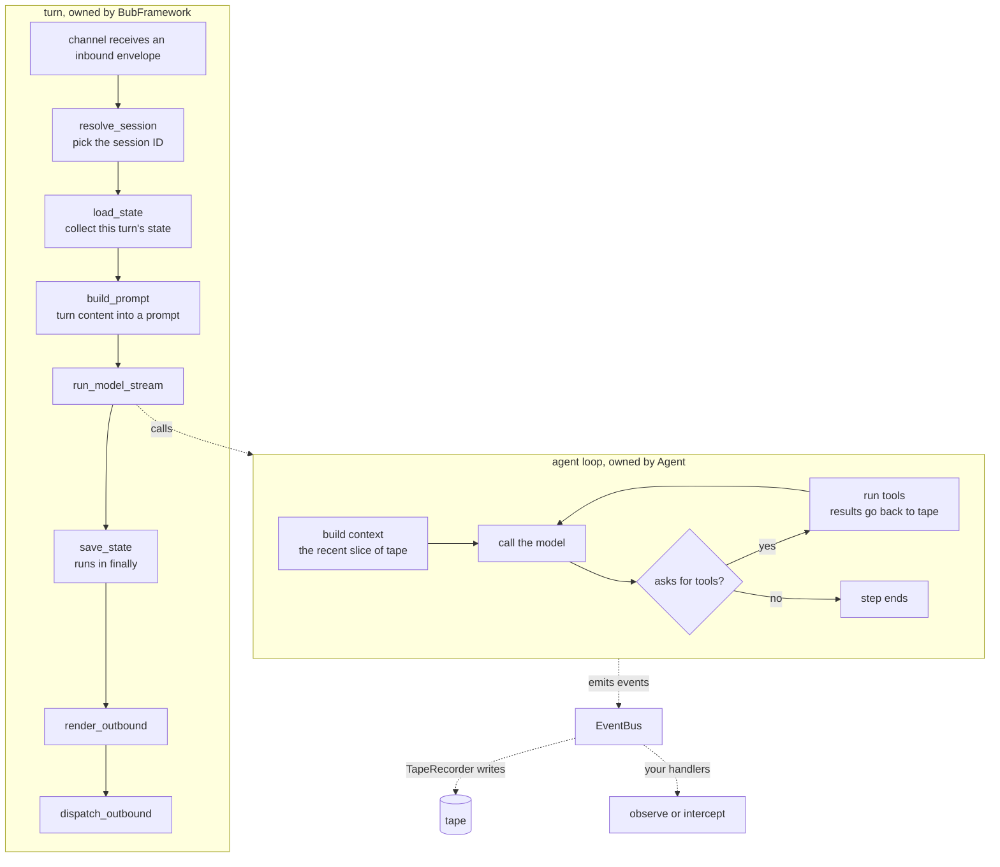

import { Aside, Card, CardGrid } from '@astrojs/starlight/components';

[Install](/docs/getting-started/install/) and the [quick start](/docs/getting-started/quickstart/) get Bub running. This section explains why it works the way it does: what happens after a message arrives, and where you step in.

Four concepts, one line each:

- A **turn** carries one inbound message through the whole app and decides where hooks are allowed.
- A **tape** stores the conversation, and holds what the next model call actually reads.
- **Events** report what each loop iteration did, and let you change your mind before the next one.
- **Extension points** answer "which layer does my addition belong in?"

Read the pages in any order, but start here: the other four expand the model below.

## The journey of a message {#journey}

Here is one ordinary question in `bub chat`, walking through a full turn.

Two boundaries in that diagram carry most of the design:

**First, a turn belongs to the app and the loop belongs to the kernel.** `BubFramework` owns the stages from inbound message to outbound reply; `core.Agent` owns the loop between the model and its tools. A direct `agent.run()` call has no turn — the prompt and tape you pass in are the whole input. The interface between the two is narrow: a prompt, a state, and a tape.

**Second, the event bus sits between them.** The loop emits an event at every step, and app-side plugins attach to those events through an adapter. A plugin never needs to know how the loop is implemented, and the loop never needs to know which plugins exist.

## Layers {#layers}

How the same capabilities are split across the two layers:

<CardGrid>
  <Card title="Kernel (bub)" icon="puzzle">
    `core.Agent`, tools, tape, context selection, the event bus, the model client.

    Everything is passed in: model, tools, prompt sections, store. It reads no settings and discovers no plugins.
  </Card>
  <Card title="App (bub[app])" icon="rocket">
    `BubAgent`, `BubFramework`, plugins and hooks, skills, commands, channels, gateways.

    Wraps the kernel into a Harness that is usable as-is, and decides how a message becomes a run.
  </Card>
</CardGrid>

`pip install bub` installs the kernel; `pip install "bub[app]"` installs both layers. These are two entry points into the same code, not two implementations: `BubAgent` is a `core.Agent` subclass, and `BubFramework` supplies the components `BubAgent` needs through hooks.

<Aside type="tip">
  The split is a progression, not a either-or choice. A common path is to start with the App and move a piece into the SDK layer once you need your own implementation of it. See [Reusing plugins](/docs/sdk/reuse-plugins/).
</Aside>

## The four concepts {#concepts}

| Concept | The question it answers | Read |
| --- | --- | --- |
| Turn | What does the app do after a message arrives, and where do I step in? | [Turn](/docs/concepts/turn/#stages) |
| Tape | Where does history live, what does the model actually read, and why can they differ? | [Tape](/docs/concepts/tape/#context) |
| Events | What does each loop iteration emit, and how do I observe, change, or stop it? | [Events](/docs/concepts/events/#call-control) |
| Extension points | Is my addition a tool, a skill, a plugin, or a channel? | [Extension points](/docs/concepts/extension-points/) |

## Terms {#terms}

These words mean one fixed thing across the docs. Learn them once; the following pages use them constantly.

**About execution.** A **run** is one `agent.run()` call, and it can contain several **steps**. A **step** is one model call and the tools it asks for. A **turn** is one inbound message and the run that answers it. They nest: turn ⊃ run ⊃ step.

**About storage.** A **tape** stores the conversation. Its **entries** are messages, tool calls, tool results, events, and anchors. An **anchor** marks where the context starts; a **handoff** writes a new anchor without deleting older entries. The turn's **state** is a separate dictionary shared by the run's model calls, tools, and handlers.

**About the app.** **Plugins** provide Python hooks. **Skills** provide written instructions and run no code. **Channels** carry messages in and out. An **envelope** is the message unit passed between channels. **Steering** is interjecting while a run is in progress.

## Design notes {#design-notes}

Three trade-offs explain why the pieces above look the way they do. Most of the remaining detail follows from them.

**History and context stay separate.** The tape keeps every entry; the context selects only what the next model call reads. Because they are separate, you can audit the full history and still send a short request. Because recording only appends, changing your mind mid-flight never corrupts what is already written.

**The kernel does not know the app.** The kernel reads no settings and knows no plugins. Hooks belong to the app: a plugin implements them, and `BubFramework` calls them. The same `core.Agent` therefore behaves the same in both layers, so behavior you verified through the SDK does not change when you adopt the App.

**Each part has one job.** A tool performs an action, a skill describes a procedure, a channel connects the app to where people work, and events observe. Roles do not overlap, so you know which part to change. It also means there is no single extension point that fits everything — first decide whether you are adding an action, knowledge, or a connection.

## Background {#background}

[Why we rewrote Bub](/posts/why-rewrite-bub/) and [Socialized evaluation and agent partnership](/posts/socialized-evaluation/) explain the earlier design. For the current interfaces, use the guides and the reference.
