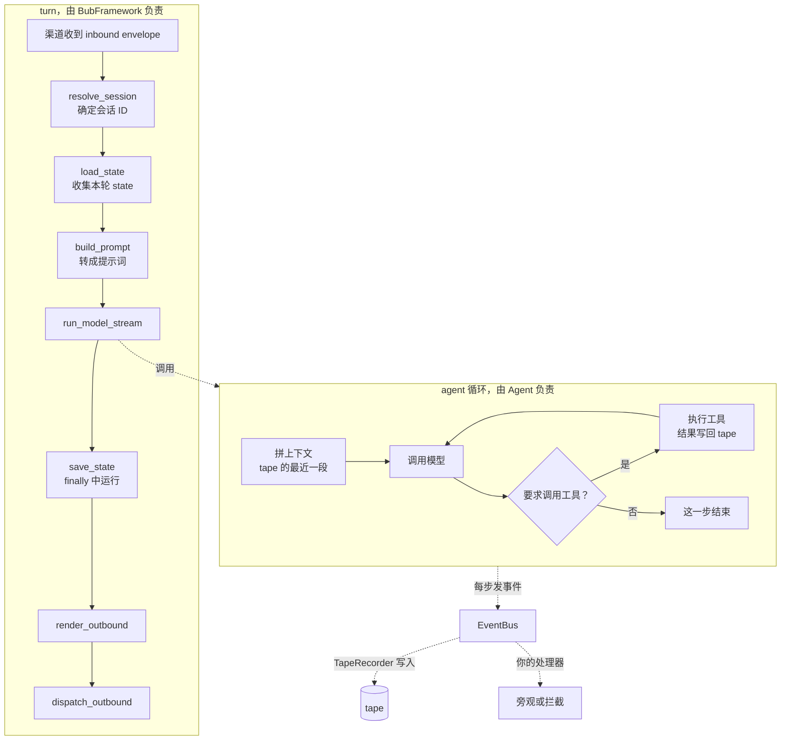

import { Aside, Card, CardGrid } from '@astrojs/starlight/components';

[安装](/zh-cn/docs/getting-started/install/)和[快速上手](/zh-cn/docs/getting-started/quickstart/)让你把 Bub 跑起来。这一节讲它为什么长这样：一条消息进来之后，究竟发生了什么，以及你在哪一步插手。

四个概念，一句话各自的分工：

- **turn** 把一条进来的消息送过整个应用，并决定在哪几步留出 hook。
- **tape** 存下这次对话，以及下一次模型调用实际读到的那一段。
- **事件** 报告循环每一步做了什么，也允许你在下一步之前改主意。
- **扩展点** 回答"我要加的东西该放哪一层"。

顺序随意，但建议先读这一页：后面的四页都在展开同一个模型。

## 一条消息的旅程 {#journey}

下面是一次 `bub chat` 里的普通提问，走完一整个 turn。

图里有两条分界线，是理解 Bub 的关键：

**第一，turn 属于应用层，循环属于内核。** `BubFramework` 负责从收到消息到发出回复的这一串阶段；`core.Agent` 负责模型和工具之间的循环。直接调 `agent.run()` 时没有 turn，你给出的提示词和 tape 就是全部输入。两者之间的接口很窄：一个 prompt、一个 state、一个 tape。

**第二，事件总线横在两者之间。** 循环每做一步都发事件，应用侧的插件通过适配器接到这些事件上。所以插件不需要知道循环内部怎么实现，循环也不需要知道有哪些插件。

## 分层 {#layers}

同名能力在两层的分工：

<CardGrid>
  <Card title="内核（bub）" icon="puzzle">
    `core.Agent`、工具、tape、上下文选择、事件总线、模型客户端。

    输入全部由你传入：模型、工具、提示词片段、存储。不读配置文件，不发现插件。
  </Card>
  <Card title="应用（bub[app]）" icon="rocket">
    `BubAgent`、`BubFramework`、插件与 hooks、技能、命令、渠道、网关。

    把内核包成一个可以直接用的 Harness，并决定一条消息怎么变成一次运行。
  </Card>
</CardGrid>

`pip install bub` 只装内核，`pip install "bub[app]"` 两层都装。两个包是同一份代码的两个入口，不是两次实现：`BubAgent` 是 `core.Agent` 的子类，`BubFramework` 通过 hook 提供 `BubAgent` 需要的组件。

<Aside type="tip">
  这个分层是渐进的，不是二选一。常见做法是先用 App 跑起来，等某个环节需要自己的实现时，再去 SDK 层替换它。见[复用插件](/zh-cn/docs/sdk/reuse-plugins/)。
</Aside>

## 四个概念 {#concepts}

| 概念 | 回答的问题 | 读哪页 |
| --- | --- | --- |
| Turn | 一条消息进来后，应用依次做了什么？我在哪一步插手？ | [Turn](/zh-cn/docs/concepts/turn/#stages) |
| Tape | 历史存在哪？模型到底读到了什么？为什么两者可以不一样？ | [Tape](/zh-cn/docs/concepts/tape/#context) |
| 事件 | 循环每一步发了什么？我怎么旁观、改写或叫停？ | [事件](/zh-cn/docs/concepts/events/#call-control) |
| 扩展点 | 我要加的东西，是工具、技能、插件，还是渠道？ | [扩展点](/zh-cn/docs/concepts/extension-points/) |

## 术语 {#terms}

这些词在整份文档里含义固定，先认一遍，后面几页会反复用到。

**运行相关。** 一次**运行**（run）是 `agent.run()` 的一次调用，里面可以有好几个**步骤**（step）。一个**步骤**是一次模型调用，以及它要求的工具。一个 **turn** 是一条进来的消息，和回答它的那次运行。三个词是包含关系：turn ⊃ run ⊃ step。

**存储相关。** **tape** 存对话，它的**条目**（entry）是消息、工具调用、工具结果、事件和 anchor。**anchor** 标出上下文的起点，**handoff** 写一个新的 anchor 而不删除旧条目。turn 的 **state** 是一个独立字典，本轮的模型调用、工具和事件处理器共用它。

**应用相关。** **插件**提供 Python hooks。**技能**（skill）写指令，不执行代码。**渠道**（channel）收发消息。**envelope** 是渠道之间传递的通信单元。**steering** 是在一轮运行进行中插话。

## 设计说明 {#design-notes}

三条取舍解释了上面这些设定为什么是这样，其余的细节都能从这三条推出来。

**历史与上下文分开。** tape 留下每一条；上下文只挑下一次模型调用要读的条目。因为分开，你可以事后查完整历史，同时只发一个短请求；也因为是追加写，中途反悔不会破坏已经记下的东西。

**内核不认识应用。** 内核不读配置，也不知道插件。hooks 属于应用：插件实现它们，`BubFramework` 调用它们。所以同一个 `core.Agent` 在两层里行为一致，你在 SDK 里验证过的行为，搬到 App 里不会变。

**每个部分只干一件事。** 工具做动作，技能写做法，渠道接入人的工作环境，事件负责观察。职责不重叠，你才知道该改哪一块。这也意味着**没有"什么都不用改"的万能扩展点**——先想清楚你要加的是动作、知识，还是连接。

## 背景 {#background}

[为什么重写 Bub](/zh-cn/posts/why-rewrite-bub/)和[社会化评估与智能体伙伴关系](/zh-cn/posts/socialized-evaluation/)讲了早期设计的来由。当前的接口和行为，以现在的指南和参考为准。
